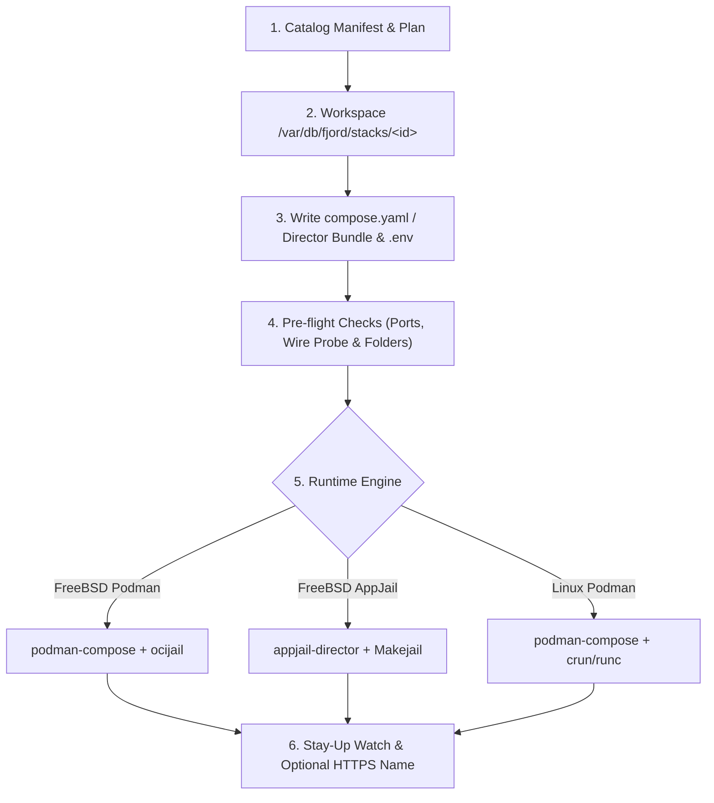

# Architecture &amp; Core Concepts

`fjord` is built around one core rule: **the filesystem is the source of truth**. Rather than locking container definitions inside an internal database, `fjordd` reads and writes standard Compose files (or AppJail director bundles) and `.env` files directly on disk, driven identically by the web UI and the [`fjord` CLI](cli.md).

```text
/var/db/fjord/
├── fjordd.sock             # Root-only local Unix socket for the fjord CLI
├── settings.json           # Storage roots, Folder Sets, catalogs, names link
├── auth.json               # Hashed administrator credentials & active sessions
└── stacks/<stack-id>/
    ├── compose.yaml            # Podman engine specification
    ├── appjail-director.yml    # AppJail director orchestration spec (FreeBSD)
    ├── Makejail                # AppJail build recipe (FreeBSD)
    ├── .env                    # Configured variables, ports & paths
    └── state.json              # Engine binding, pinned/rollback digests, recovery policy
```

Because there are no opaque lock files, operators can version `/var/db/fjord/stacks/` in Git, inspect files with standard shell tools, or invoke `podman-compose` / `appjail-director` directly.

---

## 1. Stacks

A **stack** is a self-contained application deployment: either a single container (such as Radarr or Caddy) or a multi-service topology (such as Immich with PostgreSQL, Redis, and machine-learning sidecars, each placed on the right LAN or private network).



---

## 2. Container Engines

`fjord` decouples application manifests from the execution backend:

| Characteristic | FreeBSD Podman | FreeBSD AppJail | Linux Podman |
| :--- | :--- | :--- | :--- |
| **Specification** | `compose.yaml` | `appjail-director.yml` + `Makejail` | `compose.yaml` |
| **Orchestrator** | `podman-compose` | `appjail-director` | `podman-compose` |
| **Runtime** | `ocijail` (`jail(8)`) | Native `jail(8)` via AppJail | `crun` / `runc` |
| **LAN Networking** | `cni-epair` (VNET bridge/VLAN) | VNET / bridge or `appjail-nat` | `macvlan` + `netavark` |
| **Remote Volumes** | Native NFS named volumes | Host-mounted paths | Native NFS &amp; SMB named volumes |
| **Kernel Hints** | `org.freebsd.jail.*` annotations | Director jail template parameters | Capabilities, devices &amp; SELinux `:z` |

On FreeBSD, Podman and AppJail coexist on the same host and can be chosen per stack at install time.

---

## 3. Catalogs &amp; Manifests

The App Store consumes static HTTPS **catalogs** (`catalog.json`, `manifests/<id>.yaml`, and `icons/`):

- **OS-aware defaults**: Fresh FreeBSD hosts enable the **Daemonless** catalog (`130+` native FreeBSD images, stacks, and appliances); fresh Linux hosts enable the verified **Linux** catalog (`180+` install-tested LinuxServer.io images plus multi-OS Daemonless appliances).
- **Multi-catalog merge**: Add private or custom HTTPS catalogs in **Settings → Catalogs** (or refresh via `fjord catalog refresh`). `fjordd` filters entries by host OS and CPU architecture (`amd64` / `arm64`).
- **Release channels &amp; SBOMs**: Manifests expose release trains (`latest`, `pkg`, `pkg-latest`), install-time choices (`database=postgres`), typed settings, and image SBOMs used to compute package-level update diffs.

---

## 4. Storage Boundaries

`fjord` separates internal container state from shared user libraries:

```text
Storage Layout
├── App Data Root (/var/db/fjord/containers/ or ZFS dataset)
│   ├── radarr/config/          <-- App config, SQLite DBs, logs
│   └── immich/postgres/        <-- Internal database files
└── Folder Sets (ZFS datasets / NFS / SMB)
    ├── /tank/media/movies/     <-- Shared media pools mapped across stacks
    └── /tank/downloads/
```

- **App Data**: Internal state directories created automatically with the container's `PUID`/`PGID` (and labeled for SELinux on enforcing Linux hosts).
- **Folder Sets**: Reusable host path groups (`Media`, `Downloads`, `Photos`, `Backups`) defined once in **Settings → Storage** and attached in one click during install.

---

## 5. Daemon-Owned Verification &amp; Health

Delayed outcomes belong to `fjordd`, never to an open browser tab:

1. **Pre-flight**: Probes ports, validates LAN/VLAN wire subnets and IP collisions, and creates App Data directories before launch.
2. **Post-action stay-up watch**: Every install, update, apply, and rollback watches the target containers or jails to verify they stay running, then registers any requested [HTTPS name](networking.md#names-and-local-https).
3. **Continuous health &amp; host conditions**: Background loops monitor container exit codes, restart counts, healthchecks, engine sockets, PF anchors, and `cni-epair` versions, triggering per-stack recovery policies (`do nothing`, `restart`, `stop`) and surfacing host issues in a persistent banner.

---

## 6. Lifecycle Summary

See the [FJORD Specification](spec.md) for the wire schema and provider contracts:

- **Install**: Computes the install plan (`/api/apps/<id>/plan`), runs pre-flight, provisions App Data folders, writes `.env` and compose/director files, launches the stack, verifies stay-up health, and registers its optional HTTPS name.
- **Update &amp; Rollback**: Diffs versions and SBOM packages, pulls new images safely before teardown, watches new containers for 30 seconds, and records previous digests for one-click rollback.
- **Delete**: Verifies the stack is stopped, removes containers/jails, private networks, and registered proxy names, and preserves App Data on disk unless `--purge-data` / data deletion is explicitly confirmed.
