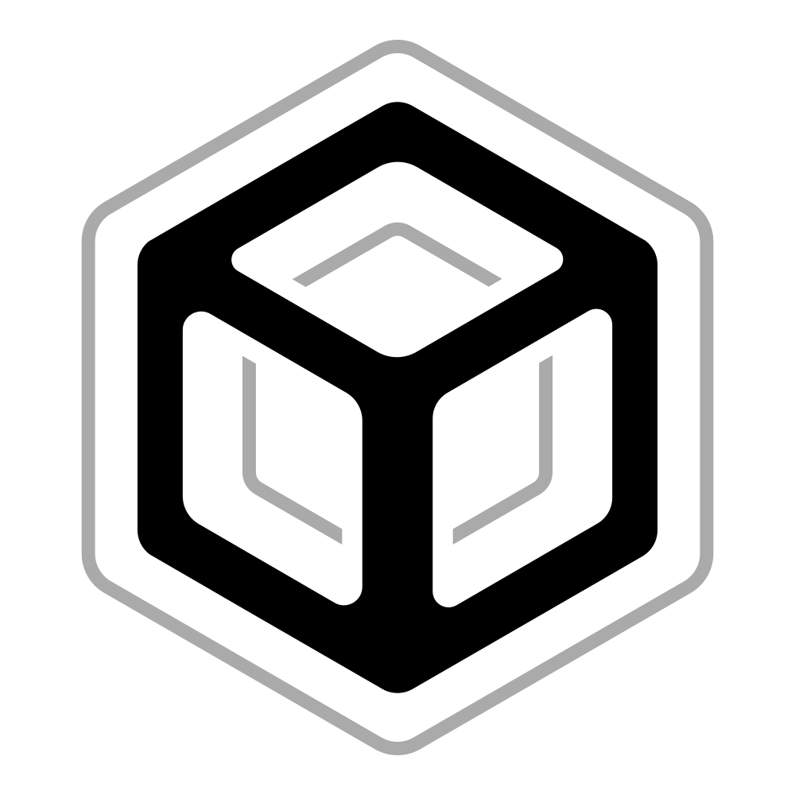
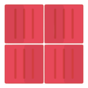

<div class="hero">
  <div class="hero-content">
    <div class="hero-logo">
      
    </div>
    <h1><span class="fj-f">f</span>jord</h1>
    <p class="hero-subtitle">FreeBSD Jail Orchestration Runtime Descriptor</p>
    <p class="hero-tagline">An open, vendor-neutral Compose standard, web UI, and CLI built for FreeBSD (Podman &amp; AppJail) and Linux (Podman). Deploy container stacks with zero VM overhead and zero proprietary appliance lock-in.</p>
    <div class="hero-buttons">
      <a href="install/" class="md-button md-button--primary">Get Started</a>
      <a href="#video-walkthrough" class="md-button">Watch Walkthrough</a>
      <a href="cli/" class="md-button">CLI Reference</a>
      <a href="spec/" class="md-button">Read the Spec</a>
      <a href="https://daemonless.io/images/" class="md-button">Browse 130+ FreeBSD Apps</a>
    </div>
  </div>
  <div class="window-frame">
    <div class="window-header">
      <span class="window-dot red"></span>
      <span class="window-dot yellow"></span>
      <span class="window-dot green"></span>
      <span class="window-title">fjord</span>
    </div>
    <div class="fj-demo" role="img" aria-label="fjord: installing Radarr from the App Store, then updating Zensical with its package diff">
      <video class="fj-demo-dark" muted loop playsinline preload="metadata" poster="img/demo/fjord-demo-dark.jpg">
        <source src="img/demo/fjord-demo-dark.webm" type="video/webm">
        <source src="img/demo/fjord-demo-dark.mp4" type="video/mp4">
      </video>
      <video class="fj-demo-light" muted loop playsinline preload="metadata" poster="img/demo/fjord-demo-light.jpg">
        <source src="img/demo/fjord-demo-light.webm" type="video/webm">
        <source src="img/demo/fjord-demo-light.mp4" type="video/mp4">
      </video>
    </div>
  </div>
</div>

<div class="fj-section fj-head">
  <h2>Up and running in a minute</h2>
  <p class="section-desc">Install <code>sysutils/fjord</code> on FreeBSD for native Podman and AppJail orchestration, or install the <code>.rpm</code> / <code>.deb</code> package on Linux for rootful Podman.</p>
</div>

<div class="fj-install-tabs" markdown>

=== "FreeBSD Package"

    ```sh
    pkg install -y fjord

    sysrc podman_service_enable=YES fjordd_enable=YES
    service podman_service start
    service fjordd start
    cat /var/db/fjord/setup-code    # open http://<host>:3567 to sign in
    ```

=== "Linux (.deb / .rpm)"

    ```sh
    V=0.4.3 A=$(uname -m | sed 's/x86_64/amd64/;s/aarch64/arm64/')
    # Fedora / RHEL
    sudo dnf install -y https://github.com/daemonless/fjord/releases/download/v$V/fjord-$V-linux-$A.rpm
    # Debian / Ubuntu
    curl -fsSLO https://github.com/daemonless/fjord/releases/download/v$V/fjord-$V-linux-$A.deb && sudo apt install -y ./fjord-$V-linux-$A.deb

    sudo cat /var/db/fjord/setup-code    # open http://<host>:3567 to sign in
    ```

=== "FreeBSD Binary"

    ```sh
    fetch -o /usr/local/sbin/fjordd https://github.com/daemonless/fjord/releases/latest/download/fjordd-freebsd-$(uname -m)
    fetch -o /usr/local/etc/rc.d/fjordd https://github.com/daemonless/fjord/releases/latest/download/fjordd.rc
    chmod 755 /usr/local/sbin/fjordd /usr/local/etc/rc.d/fjordd
    ln -sf fjordd /usr/local/sbin/fjord

    sysrc fjordd_enable=YES
    service fjordd start    # open http://<host>:3567
    ```

=== "From Source"

    ```sh
    pkg install -y git go npm
    git clone https://github.com/daemonless/fjord && cd fjord
    (cd ui && npm ci && npm run build) && go build -o fjordd ./cmd/fjordd
    install -m 755 fjordd /usr/local/sbin/fjordd
    ln -sf fjordd /usr/local/sbin/fjord
    install -m 755 packaging/fjordd.rc /usr/local/etc/rc.d/fjordd

    sysrc fjordd_enable=YES
    service fjordd start    # open http://<host>:3567
    ```

</div>

<div class="fj-section" id="video-walkthrough">
  <h2>See It in Action</h2>
  <p class="section-desc">Watch a 6-minute walkthrough from a fresh FreeBSD 15 package install through Podman &amp; AppJail stacks, real LAN IP discovery, zero-config local HTTPS, image channel switching, adopting existing containers, and Linux support.</p>
  <div class="window-frame fj-video-frame">
    <div class="window-header">
      <span class="window-dot red"></span>
      <span class="window-dot yellow"></span>
      <span class="window-dot green"></span>
      <span class="window-title">fjord — 6-minute walkthrough</span>
      <a href="https://youtu.be/8S3hEVyCUzc" target="_blank" rel="noopener" class="window-badge">
        <svg xmlns="http://www.w3.org/2000/svg" width="13" height="13" viewBox="0 0 24 24" fill="none" stroke="currentColor" stroke-width="2" stroke-linecap="round" stroke-linejoin="round"><path d="M18 13v6a2 2 0 0 1-2 2H5a2 2 0 0 1-2-2V8a2 2 0 0 1 2-2h6"/><polyline points="15 3 21 3 21 9"/><line x1="10" y1="14" x2="21" y2="3"/></svg>
        Watch on YouTube
      </a>
    </div>
    <div class="fj-video-embed">
      <iframe
        src="https://www.youtube-nocookie.com/embed/8S3hEVyCUzc?rel=0"
        title="Fjord: Self-Hosted Container &amp; Jail App Store for FreeBSD (Podman, AppJail &amp; Linux)"
        allow="accelerometer; autoplay; clipboard-write; encrypted-media; gyroscope; picture-in-picture; web-share"
        referrerpolicy="strict-origin-when-cross-origin"
        allowfullscreen
        loading="lazy">
      </iframe>
    </div>
  </div>
</div>

<div class="fj-section">
  <h2>A Horizontal Standard, Not a Vertical Appliance</h2>
  <p class="section-desc">Many container platforms achieve one-click app stores by building vertical silos: dedicated storage and appliance distributions deliver convenience only by locking operators into a captive OS, a proprietary UI, and an opinionated orchestrator.</p>
  <p class="section-desc">FreeBSD already provides kernel primitives built for multi-tenant isolation and storage: <strong>Jails</strong>, <strong>ZFS datasets</strong>, <strong>VNET</strong>, and <strong>devfs rulesets</strong>. FreeBSD does not need a proprietary vertical appliance. It needs an <strong>open, horizontal standard</strong>.</p>
</div>

<div class="fj-section fj-install" markdown>
  <h2>Pure Compose + Declarative Host Hints</h2>
  <p class="section-desc">FJORD extends standard <code>compose.yaml</code> files with a reserved <code>x-fjord</code> block. Upstream definitions remain 100% valid on Linux/Docker, while compliant FreeBSD tools automatically provision ZFS datasets, map UID/GID permissions, and configure jail parameters.</p>

```yaml title="compose.yaml"
services:
  plex:
    image: ghcr.io/daemonless/plex:latest # (1)
    ports:
      - "${WEB_PORT}:32400" # (2)
    volumes:
      - ${CONFIG_DATA}:/config # (3)
      - ${MEDIA_PATH}:/media:ro
    annotations:
      org.freebsd.jail.param.allow.raw_sockets: "1" # (4)

# Declarative FreeBSD host provisioning & UI wizard schema
x-fjord:
  version: "1.0"
  info:
    name: "Plex Media Server"
    category: "Media"
    class: "service"
  host:
    vnet_required: true # (5)
    devfs_rules:
      - "add path 'drm/*' unhide" # (6)
  variables:
    - name: CONFIG_DATA
      label: "Config storage dataset"
      type: zfs_dataset # (7)
      zfs_properties:
        recordsize: "16K"
        compression: "lz4"
      host_permissions:
        uid: 972
        gid: 972
        mode: "755"
```

1.  :material-server: **FreeBSD-Native Image**: Runs directly on the FreeBSD kernel without Linux emulation or virtual machines.
2.  :material-lan-connect: **Typed Port Binding**: Configured via the deployment wizard with automated host conflict detection.
3.  :material-database: **App Data Folder**: A folder under the stack's App Data, created before launch.
4.  :material-security: **Kernel Jail Parameter**: Standard OCI annotation translated directly into jail parameters by `ocijail`.
5.  :material-network: **VNET Stack**: Asks for a jail with its own network stack. Part of the spec; fjord does not act on it yet.
6.  :material-expansion-card: **Hardware Passthrough**: A devfs rule for GPU transcoding (`/dev/drm/*`). Part of the spec; fjord does not act on it yet.
7.  :material-folder-cog: **Storage Automation**: fjord creates the folder and gives it to the app's UID/GID before launch. ZFS datasets with these properties are on the roadmap.

</div>

<div class="fj-section">
  <h2>How fjord Orchestrates Workloads</h2>
  <p class="section-desc">fjord translates standard Compose declarations into native FreeBSD jails and Podman containers without proprietary state locks or VM overhead.</p>
  <div class="fj-steps">
    <div class="fj-step">
      <div class="fj-step-index">01 / Catalog Discovery</div>
      <h3>Verified OCI Catalogs</h3>
      <p>Browse 130+ FreeBSD-native apps from the <a href="https://daemonless.io/images/">Daemonless fleet</a> (plus 180+ tested Linux apps on Linux hosts) or attach private catalogs. Incompatible CPU architectures are filtered automatically.</p>
    </div>
    <div class="fj-step">
      <div class="fj-step-index">02 / Specification</div>
      <h3>Filesystem Ground Truth</h3>
      <p>Every stack writes plain <code>compose.yaml</code> and <code>.env</code> files in <code>/var/db/fjord/stacks/</code>. Operate stacks from the web UI, the built-in <code>fjord</code> CLI, or standard shell tools with zero drift.</p>
    </div>
    <div class="fj-step">
      <div class="fj-step-index">03 / Orchestration</div>
      <h3>Checked Lifecycle &amp; Health</h3>
      <p>Deploy through <code>podman-compose</code> (with <code>ocijail</code> on FreeBSD) or <code>appjail-director</code>. Pre-flight checks ports and permissions, background health watches verify every update, and automatic recovery keeps stacks up.</p>
    </div>
  </div>
</div>

<div class="fj-section">
  <h2>Key Capabilities</h2>
  <p class="section-desc">Engineered for FreeBSD systems administrators, appliances, and production self-hosted infrastructure, with first-class Linux Podman support.</p>
</div>

<div class="grid cards fj-cards" markdown>

-   :material-server: **Native Jail Containment**

    ---

    Zero Linux VM overhead on FreeBSD. Workloads execute directly on the FreeBSD kernel with native ZFS performance, resource isolation, and VNET or bridge networking.

-   :material-source-branch: **Dual-Engine &amp; Cross-OS**

    ---

    Run Podman (with `ocijail`) and native FreeBSD jails via `appjail-director` side by side on FreeBSD, selectable per stack, or run the same UI and CLI on Linux with rootful Podman.

-   :material-console: **Web UI + `fjord` CLI**

    ---

    One static Go binary (`fjordd`) serves both the browser interface and the `fjord` command (`fjord ls`, `fjord install`, `fjord update --all`, `fjord logs -f`, `fjord rollback`, `fjord exec`).

-   :material-shield-lock-outline: **Names &amp; Local HTTPS**

    ---

    Pair with the Daemonless Reverse Proxy to give any stack a clean HTTPS name like `https://radarr.apps.lan` at install time, tracking port and LAN address changes automatically.

-   :material-update: **SBOM Diffs, Rollback &amp; Health Watch**

    ---

    Review exact application and OS package changes from image SBOMs before running **Update all**, watch updated services stay healthy, and roll back any service in one click.

-   :material-file-document-edit: **Filesystem-First Source of Truth**

    ---

    No hidden databases or opaque lock files. Every stack is a plain directory containing `compose.yaml` and `.env` (or an AppJail director bundle) editable in CodeMirror or `vi`.

-   :material-folder-network: **Structured Storage &amp; Folder Sets**

    ---

    Separate internal application state from shared data pools. Declare local ZFS paths, NFS exports, or SMB shares once as Folder Sets and attach them across stacks.

-   :material-import: **Adopt What's Already Running**

    ---

    Containers and jails started by hand or by Ansible become managed stacks in one click, keeping their image, mounts, network address, MAC, and name in place without moving data.

-   :material-stethoscope: **Continuous Host &amp; Stack Checks**

    ---

    Background checks monitor engine sockets, PF anchors, `cni-epair`, SELinux/firewalls, and per-stack restart loops, surfacing actionable fixes in a persistent banner.

</div>

<div class="fj-section">
  <h2>Already running containers? Adopt them.</h2>
  <p class="section-desc">A host built with <code>podman run</code> lines, <code>appjail quick</code>, an Ansible playbook, or a shell script does not have to start over. fjord lists every container and jail no stack owns, shows the stack it would write, and replaces it in place.</p>
</div>

<div class="fj-adopt" markdown>

```
podman run -d --name radarr --network vlan5 --ip 192.168.5.13 --mac-address 0e:05:00:00:00:0d \
  -e PUID=1000 -e PGID=1000 -e TZ=America/New_York \
  -v /containers/radarr:/config -v /nas/media:/media \
  --annotation org.freebsd.jail.allow.mlock=true ghcr.io/daemonless/radarr:latest
```

becomes

```yaml
services:
  radarr:
    image: ghcr.io/daemonless/radarr:latest
    container_name: radarr
    restart: always
    mac_address: 0e:05:00:00:00:0d
    environment:
      - PUID=${PUID}
      - PGID=${PGID}
      - TZ=${TZ}
    volumes:
      - "/containers/radarr:/config"
      - "/nas/media:/media"
    annotations:
      org.freebsd.jail.allow.mlock: "true"
    networks:
      vlan5:
        ipv4_address: 192.168.5.13

networks:
  vlan5:
    external: true
```

On the AppJail engine the same happens for a jail: its image, virtual network and address, exposes, mounts, environment and jail parameters are read back into an `appjail-director.yml`, `Makejail` and `template.conf`, the same files a catalog install produces. The setup wizard offers this on first run, the Stacks page offers it whenever unmanaged containers or jails exist, and **Adopt &amp; replace all** converts a whole host in one pass. Each stack keeps its name, so DHCP reservations, DNS and bookmarks keep working.

</div>

<div class="fj-adopt-shot">
  <div class="window-frame">
    <div class="window-header">
      <span class="window-dot red"></span>
      <span class="window-dot yellow"></span>
      <span class="window-dot green"></span>
      <span class="window-title">fjord — adopt</span>
      <span class="window-badge">
        <svg xmlns="http://www.w3.org/2000/svg" width="13" height="13" viewBox="0 0 24 24" fill="none" stroke="currentColor" stroke-width="2" stroke-linecap="round" stroke-linejoin="round"><path d="m21 21-6-6m6 6v-4.8m0 4.8h-4.8"/><path d="M3 16.2V21m0 0h4.8M3 21l6-6"/><path d="M21 7.8V3m0 0h-4.8M21 3l-6 6"/><path d="M3 7.8V3m0 0h4.8M3 3l6 6"/></svg>
        Click to Zoom
      </span>
    </div>
    <a href="img/adopt-dark.png" class="glightbox" data-gallery="fjord-dark">
      
    </a>
    <a href="img/adopt-light.png" class="glightbox" data-gallery="fjord-light">
      
    </a>
  </div>
</div>

<div class="fj-section interface-showcase">
  <h2>Interface &amp; Diagnostics</h2>
  <p class="section-desc">Inspect runtime state, edit compose specifications directly on disk, and proactively audit host kernel, socket, and network readiness.</p>
</div>

=== ":material-layers: Stack Lifecycle &amp; Editor"

    <div class="window-frame">
      <div class="window-header">
        <span class="window-dot red"></span>
        <span class="window-dot yellow"></span>
        <span class="window-dot green"></span>
        <span class="window-title">fjord — stacks / zensical</span>
        <span class="window-badge">
          <svg xmlns="http://www.w3.org/2000/svg" width="13" height="13" viewBox="0 0 24 24" fill="none" stroke="currentColor" stroke-width="2" stroke-linecap="round" stroke-linejoin="round"><path d="m21 21-6-6m6 6v-4.8m0 4.8h-4.8"/><path d="M3 16.2V21m0 0h4.8M3 21l6-6"/><path d="M21 7.8V3m0 0h-4.8M21 3l-6 6"/><path d="M3 7.8V3m0 0h4.8M3 3l6 6"/></svg>
          Click to Zoom
        </span>
      </div>
    <a href="img/stack-dark.png" class="glightbox" data-gallery="fjord-dark">
      
    </a>
    <a href="img/stack-light.png" class="glightbox" data-gallery="fjord-light">
      
    </a>
    </div>

    <div class="showcase-feature-strip">
      <div class="showcase-feature-card">
        <h4>
          <svg xmlns="http://www.w3.org/2000/svg" viewBox="0 0 24 24" fill="none" stroke="currentColor" stroke-width="2" stroke-linecap="round" stroke-linejoin="round"><path d="M14.5 2H6a2 2 0 0 0-2 2v16a2 2 0 0 0 2 2h12a2 2 0 0 0 2-2V7.5L14.5 2z"/><polyline points="14 2 14 8 20 8"/><line x1="16" y1="13" x2="8" y2="13"/><line x1="16" y1="17" x2="8" y2="17"/><polyline points="10 9 9 9 8 9"/></svg>
          Filesystem-Backed Editor
        </h4>
        <p>Integrated CodeMirror editor with syntax highlighting for <code>compose.yaml</code>, <code>Makejail</code>, and <code>.env</code>. Edits save straight to disk; Apply reconciles the running stack.</p>
      </div>
      <div class="showcase-feature-card">
        <h4>
          <svg xmlns="http://www.w3.org/2000/svg" viewBox="0 0 24 24" fill="none" stroke="currentColor" stroke-width="2" stroke-linecap="round" stroke-linejoin="round"><polyline points="4 17 10 11 4 5"/><line x1="12" y1="19" x2="20" y2="19"/></svg>
          In-Browser Container Shell
        </h4>
        <p>Instant terminal sessions connected directly into running jail workloads via WebSocket. Run diagnostics, inspect mount permissions, and verify jail processes.</p>
      </div>
      <div class="showcase-feature-card">
        <h4>
          <svg xmlns="http://www.w3.org/2000/svg" viewBox="0 0 24 24" fill="none" stroke="currentColor" stroke-width="2" stroke-linecap="round" stroke-linejoin="round"><path d="M21 15a2 2 0 0 1-2 2H7l-4 4V5a2 2 0 0 1 2-2h14a2 2 0 0 1 2 2z"/></svg>
          Real-Time Output Drawer
        </h4>
        <p>Live standard output and error from <code>podman-compose up</code> and <code>appjail-director up</code>, streamed as they run.</p>
      </div>
    </div>

=== ":material-auto-fix: Deployment Wizard"

    <div class="window-frame">
      <div class="window-header">
        <span class="window-dot red"></span>
        <span class="window-dot yellow"></span>
        <span class="window-dot green"></span>
        <span class="window-title">fjord — deployment wizard</span>
        <span class="window-badge">
          <svg xmlns="http://www.w3.org/2000/svg" width="13" height="13" viewBox="0 0 24 24" fill="none" stroke="currentColor" stroke-width="2" stroke-linecap="round" stroke-linejoin="round"><path d="m21 21-6-6m6 6v-4.8m0 4.8h-4.8"/><path d="M3 16.2V21m0 0h4.8M3 21l6-6"/><path d="M21 7.8V3m0 0h-4.8M21 3l-6 6"/><path d="M3 7.8V3m0 0h4.8M3 3l6 6"/></svg>
          Click to Zoom
        </span>
      </div>
      <a href="img/install-wizard-dark.png" class="glightbox" data-gallery="fjord-dark">
        
      </a>
      <a href="img/install-wizard-light.png" class="glightbox" data-gallery="fjord-light">
        
      </a>
    </div>

    <div class="showcase-feature-strip">
      <div class="showcase-feature-card">
        <h4>
          <svg xmlns="http://www.w3.org/2000/svg" viewBox="0 0 24 24" fill="none" stroke="currentColor" stroke-width="2" stroke-linecap="round" stroke-linejoin="round"><circle cx="12" cy="12" r="10"/><line x1="12" y1="8" x2="12" y2="12"/><line x1="12" y1="16" x2="12.01" y2="16"/></svg>
          Automated Port Pre-Flights
        </h4>
        <p>Probes every published port — and the EXPOSE ports of host-network sidecars — before anything starts, naming the container that holds one, so a taken port is a clear message instead of a crash loop.</p>
      </div>
      <div class="showcase-feature-card">
        <h4>
          <svg xmlns="http://www.w3.org/2000/svg" viewBox="0 0 24 24" fill="none" stroke="currentColor" stroke-width="2" stroke-linecap="round" stroke-linejoin="round"><path d="M22 19a2 2 0 0 1-2 2H4a2 2 0 0 1-2-2V5a2 2 0 0 1 2-2h5l2 3h9a2 2 0 0 1 2 2z"/></svg>
          One-Click Folder Sets
        </h4>
        <p>Attach pre-configured local paths or NFS/SMB endpoints (e.g. Media, Downloads, Photos) with a single dropdown selection.</p>
      </div>
      <div class="showcase-feature-card">
        <h4>
          <svg xmlns="http://www.w3.org/2000/svg" viewBox="0 0 24 24" fill="none" stroke="currentColor" stroke-width="2" stroke-linecap="round" stroke-linejoin="round"><circle cx="12" cy="12" r="10"/><polyline points="12 6 12 12 16 14"/></svg>
          Release Channel Control
        </h4>
        <p>Switch between upstream application releases (<code>latest</code>), FreeBSD Quarterly (<code>pkg</code>), and FreeBSD Latest (<code>pkg-latest</code>) with tag or digest pinning.</p>
      </div>
    </div>

=== ":material-stethoscope: Host Readiness Diagnostics"

    <div class="showcase-split">
      <div class="showcase-split-image">
        <div class="window-frame">
          <div class="window-header">
            <span class="window-dot red"></span>
            <span class="window-dot yellow"></span>
            <span class="window-dot green"></span>
            <span class="window-title">fjord — setup</span>
            <span class="window-badge">
              <svg xmlns="http://www.w3.org/2000/svg" width="13" height="13" viewBox="0 0 24 24" fill="none" stroke="currentColor" stroke-width="2" stroke-linecap="round" stroke-linejoin="round"><path d="m21 21-6-6m6 6v-4.8m0 4.8h-4.8"/><path d="M3 16.2V21m0 0h4.8M3 21l6-6"/><path d="M21 7.8V3m0 0h-4.8M21 3l-6 6"/><path d="M3 7.8V3m0 0h4.8M3 3l6 6"/></svg>
              Click to Zoom
            </span>
          </div>
    <a href="img/setup-dark.png" class="glightbox" data-gallery="fjord-dark">
      
    </a>
    <a href="img/setup-light.png" class="glightbox" data-gallery="fjord-light">
      
    </a>
        </div>
      </div>
      <div class="showcase-split-details">
        <div class="showcase-split-item">
          <h4>
            <svg xmlns="http://www.w3.org/2000/svg" viewBox="0 0 24 24" fill="none" stroke="currentColor" stroke-width="2" stroke-linecap="round" stroke-linejoin="round"><path d="M22 12h-4l-3 9L9 3l-3 9H2"/></svg>
            Libpod Socket &amp; Service Health
          </h4>
          <p>Checks that <code>/var/run/podman/podman.sock</code> answers, on every visit and on Re-check — a dead socket is the usual reason the podman engine goes blind.</p>
        </div>
        <div class="showcase-split-item">
          <h4>
            <svg xmlns="http://www.w3.org/2000/svg" viewBox="0 0 24 24" fill="none" stroke="currentColor" stroke-width="2" stroke-linecap="round" stroke-linejoin="round"><rect x="3" y="11" width="18" height="11" rx="2" ry="2"/><path d="M7 11V7a5 5 0 0 1 10 0v4"/></svg>
            PF Firewall Redirection Anchors
          </h4>
          <p>Verifies that Packet Filter (PF) anchors (<code>cni-rdr/*</code> and <code>appjail-nat/*</code>) are loaded in the kernel so container bridge port forwarding never hangs.</p>
        </div>
        <div class="showcase-split-item">
          <h4>
            <svg xmlns="http://www.w3.org/2000/svg" viewBox="0 0 24 24" fill="none" stroke="currentColor" stroke-width="2" stroke-linecap="round" stroke-linejoin="round"><circle cx="12" cy="12" r="3"/><path d="M19.4 15a1.65 1.65 0 0 0 .33 1.82l.06.06a2 2 0 0 1 0 2.83 2 2 0 0 1-2.83 0l-.06-.06a1.65 1.65 0 0 0-1.82-.33 1.65 1.65 0 0 0-1 1.51V21a2 2 0 0 1-2 2 2 2 0 0 1-2-2v-.09A1.65 1.65 0 0 0 9 19.4a1.65 1.65 0 0 0-1.82.33l-.06.06a2 2 0 0 1-2.83 0 2 2 0 0 1 0-2.83l.06-.06a1.65 1.65 0 0 0 .33-1.82 1.65 1.65 0 0 0-1.51-1H3a2 2 0 0 1-2-2 2 2 0 0 1 2-2h.09A1.65 1.65 0 0 0 4.6 9a1.65 1.65 0 0 0-.33-1.82l-.06-.06a2 2 0 0 1 0-2.83 2 2 0 0 1 2.83 0l.06.06a1.65 1.65 0 0 0 1.82.33H9a1.65 1.65 0 0 0 1-1.51V3a2 2 0 0 1 2-2 2 2 0 0 1 2 2v.09a1.65 1.65 0 0 0 1 1.51 1.65 1.65 0 0 0 1.82-.33l.06-.06a2 2 0 0 1 2.83 0 2 2 0 0 1 0 2.83l-.06.06a1.65 1.65 0 0 0-.33 1.82V9a1.65 1.65 0 0 0 1.51 1H21a2 2 0 0 1 2 2 2 2 0 0 1-2 2h-.09a1.65 1.65 0 0 0-1.51 1z"/></svg>
            Supervision &amp; OCI Jail Runtimes
          </h4>
          <p>Audits <code>conmon</code> (I/O monitor) and <code>ocijail</code> (0.6.0+), preventing umask privilege leaks into unprivileged jails.</p>
        </div>
        <div class="showcase-split-item">
          <h4>
            <svg xmlns="http://www.w3.org/2000/svg" viewBox="0 0 24 24" fill="none" stroke="currentColor" stroke-width="2" stroke-linecap="round" stroke-linejoin="round"><path d="M14.7 6.3a1 1 0 0 0 0 1.4l1.6 1.6a1 1 0 0 0 1.4 0l3.77-3.77a6 6 0 0 1-7.94 7.94l-6.91 6.91a2.12 2.12 0 0 1-3-3l6.91-6.91a6 6 0 0 1 7.94-7.94l-3.76 3.76z"/></svg>
            One-Click Shell Remediation
          </h4>
          <p>Every audit provides copy-paste shell commands to immediately install missing utilities, enable rc services, or reload firewall rules.</p>
        </div>
      </div>
    </div>

<div class="fj-section">
  <div class="fj-advisory">
    <div class="fj-advisory-icon">
      <svg xmlns="http://www.w3.org/2000/svg" width="22" height="22" viewBox="0 0 24 24" fill="none" stroke="currentColor" stroke-width="2" stroke-linecap="round" stroke-linejoin="round"><circle cx="12" cy="12" r="10"/><line x1="12" y1="8" x2="12" y2="12"/><line x1="12" y1="16" x2="12.01" y2="16"/></svg>
    </div>
    <div class="fj-advisory-content">
      <h4>Sign-In &amp; Network Security</h4>
      <p>fjord requires an administrator sign-in claimed on first boot via a root-only setup code (<code>/var/db/fjord/setup-code</code>), and <code>fjordd</code> manages container runtimes as root. Because <code>fjordd</code> listens over plain HTTP on port <code>3567</code> by default, keep port <code>3567</code> on a trusted LAN/VPN or place an HTTPS reverse proxy in front (<code>FJORD_TRUSTED_PROXY</code>); never expose port <code>3567</code> directly to the internet.</p>
    </div>
  </div>
</div>

<div class="fj-section">
  <h2>Friends in the FreeBSD Ecosystem</h2>
  <p class="section-desc">fjord focuses purely on container and jail stack orchestration. If you want a full-featured hypervisor or a dedicated ZFS storage appliance, explore these FreeBSD ecosystem platforms that support <a href="https://daemonless.io">Daemonless</a> OCI images natively:</p>
</div>

<div class="grid cards fj-cards" markdown>

-   { .fj-logo } **Sylve**

    ---

    **Want a full-featured VM, Jail, and ZFS management platform?** Sylve brings Bhyve virtual machines, FreeBSD Jails, ZFS pools, networking, and clustering together in a single modern web UI with native support for Daemonless OCI containers.

    [:octicons-arrow-right-24: sylve.io](https://sylve.io)

-   { .fj-logo } **FreeCORE**

    ---

    **Want a dedicated FreeBSD 15 and OpenZFS storage appliance?** FreeCORE delivers turnkey NAS and ZFS pool management on FreeBSD 15 with native Daemonless container support.

    [:octicons-arrow-right-24: freecore.org](https://freecore.org)

-   { .fj-logo } **AppJail**

    ---

    **Want deep CLI jail automation and orchestration?** AppJail is the powerhouse FreeBSD-native jail framework and first-class engine backend in fjord.

    [:octicons-arrow-right-24: appjail.readthedocs.io](https://appjail.readthedocs.io)

</div>

<div class="fj-section fj-build" id="build-your-own">
  <div class="fj-build-panel">
    <p class="fj-build-kicker">An open spec</p>
    <h2>Don't like what you see? <span class="fj-build-accent">Build your own.</span></h2>
    <p class="fj-build-desc">fjord, Sylve and FreeCORE each put their own interface on Daemonless containers. The app catalog and the manifest format are an open spec, so your CLI, TUI or web UI can install the same apps.</p>
    <div class="fj-build-slots" aria-hidden="true">
      <span class="fj-build-slot">fjord</span>
      <span class="fj-build-slot">Sylve</span>
      <span class="fj-build-slot">FreeCORE</span>
      <span class="fj-build-slot fj-build-slot--yours">+ yours</span>
    </div>
    <a href="spec/" class="md-button md-button--primary">Read the spec</a>
  </div>
</div>

<div class="fj-section fj-cta">
  <a href="install/" class="md-button md-button--primary">Install fjord</a>
  <a href="https://youtu.be/8S3hEVyCUzc" class="md-button">Watch on YouTube</a>
  <a href="spec/" class="md-button">Read the Specification</a>
  <a href="concepts/" class="md-button">Explore Architecture</a>
  <a href="https://github.com/daemonless/fjord" class="md-button">GitHub Repository</a>
</div>
