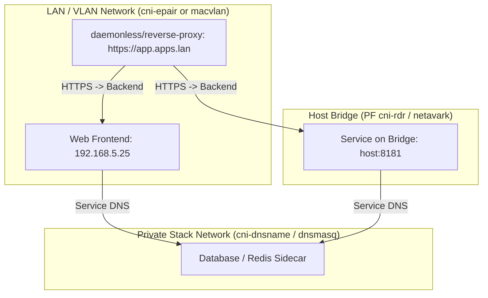

# Networking &amp; Local HTTPS

Every service in a stack connects to one or more networks, viewable and editable at install time or on the stack's **Services** tab.

---

## 1. Where a Service Can Live

| Network | Reached At | Best For |
| :--- | :--- | :--- |
| **bridge** (default) | Host IP on published ports (`http://host:8181`) | Most single-service apps; zero switch/router setup |
| **host** | Host IP on the ports the process binds directly | mDNS, DHCP, or network discovery services |
| **LAN / VLAN** | Dedicated IP on your switch or VLAN (`http://192.168.5.25`) | Giving an app its own LAN IP, DHCP reservation, firewall rules, and zero port conflicts |
| **private** | Only by sibling services inside the same stack | Databases, caches, and workers (`postgres`, `redis`, `immich-ml`) |

Multi-service stacks attach the web frontend to your default or LAN network and isolate databases and workers on the stack's own private network (`<stack>_default`), never sharing private networks or `epair` interfaces between similarly named stacks.

---

## 2. Names &amp; Local HTTPS (`reverse-proxy`) { #names-and-local-https }

When you install the **Daemonless Reverse Proxy** (`daemonless/reverse-proxy`) from the App Store (or link an existing instance under **Settings → Names**), `fjord` pairs with it automatically over its `/api/v1` names-provider API:

- **One-click HTTPS names**: Give any web stack a clean name such as `https://radarr.apps.lan` in the install wizard (`--given-name radarr` in the [CLI](cli.md)) or later from the **`Open ▾`** menu (**By name**, **Direct**, **Change name**, **Remove name**, or **Never name this**).
- **Daemon-owned registration**: `fjordd` registers the name after the stack passes its stay-up check, syncs the application's icon to the proxy dashboard, and records the assigned URL in **Output**.
- **Automatic target tracking**: If a stack's port or LAN IP changes later, `fjordd` updates its upstream target on `reverse-proxy` automatically, and removes the host entry on stack teardown.
- **Trust &amp; multi-host linking**: A shield chip beside **Open** tells you whether your browser trusts the proxy's local CA (with a direct link to install the root certificate) and whether DNS resolves. Multiple `fjord` hosts on your network (FreeBSD and Linux) can share one `reverse-proxy` appliance by pasting a single pairing link in **Settings → Names**.

---

## 3. Dedicated LAN &amp; VLAN Networks

{ .glightbox }
{ .glightbox }

A LAN network attaches containers or jails directly to a physical interface or VLAN so each workload gets its own L2 address on your network.

=== "FreeBSD (`cni-epair` &amp; VNET)"

    - **Plugin**: Uses [`cni-epair`](https://github.com/daemonless/cni-epair) (**v1.2.1+**, installed automatically by `sysutils/fjord` or **Setup → Set up**). Version `1.2.1+` isolates container DHCP client identifiers so containers never overwrite the host's own DHCP hostname on your router.
    - **Host Bridge**: Attaches to a FreeBSD `bridge(4)` containing your physical NIC or `vlan(4)` sub-interface. If none exists yet, **Networks → New network** displays the exact `ifconfig` and `rc.conf` commands.
    - **Wire Probe**: When creating a LAN network on an unnumbered VLAN bridge, `fjordd` runs a caged DHCP probe to auto-fill and validate the subnet and gateway.

=== "Linux (`macvlan` &amp; `netavark`)"

    - **Driver**: Creates a Podman `macvlan` network bound to your host NIC or VLAN interface (`eth0`, `eno1.20`).
    - **DHCP or Pool**: For DHCP leases on Linux, enable Netavark's DHCP proxy (`systemctl enable --now netavark-dhcp-proxy.socket`); `fjord` pins the container MAC so router reservations stay permanent. Alternatively, use a **Pool** range where `fjord` pins static IPs directly.

### Address Allocation Modes
- **DHCP**: Your router assigns the lease; `fjord` pins and saves the container's MAC address in `compose.yaml` so leases and router reservations persist across updates and reboots.
- **Pool**: `fjord` allocates an unused IP from a range you define, probing the wire via ARP/ICMP first so an address already held by another machine on your LAN is skipped automatically.
- **Static**: You assign each service's IPv4 (and optional IPv6) address explicitly.

---

## 4. Service Discovery &amp; AppJail Networking

- **Podman service DNS**: Services sharing a stack network resolve each other by service name (`postgres://database:5432`) via `cni-dnsname` on FreeBSD (`aardvark-dns` on Linux), checked automatically on **System**.
- **AppJail virtual &amp; LAN networks**: AppJail stacks run on virtual NAT bridges (`appjail-nat` PF anchors) with automatic `dnsmasq` service discovery across dynamic bridges from first boot, or directly on LAN bridges with fixed or DHCP-acquired addresses.
